# openKVM

**Un mini KVM-over-IP ouvert, matériel compris.** Tu le branches sur le HDMI et l'USB d'une machine, et tu la pilotes
depuis un navigateur : écran, clavier, souris, démarrage sur une image ISO, jusque dans le BIOS.

| Carte (pré-placement) | Boîtier (concept) |
|---|---|
| 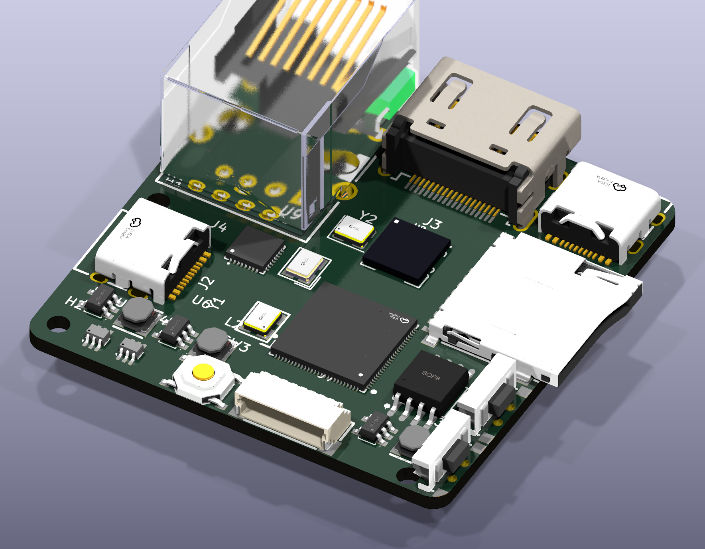 | 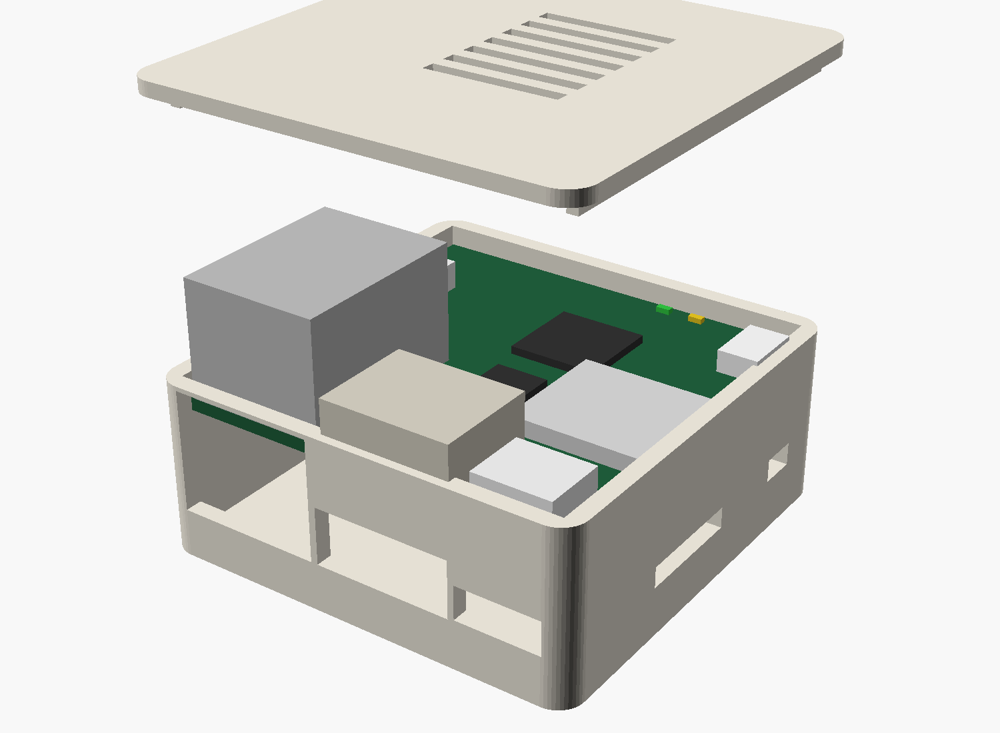 |

> ⚠️ **État du projet : en conception.** Rien n'a encore été fabriqué ni testé. Les images ci-dessus sont des
> **rendus** : la carte est pré-placée mais **pas routée**, et le boîtier est un concept. Ne lance aucune fabrication
> à partir de ces fichiers sans la revue humaine décrite dans [`docs/04`](docs/04-schema-electronique.md#6-points-à-faire-relire-par-un-humain-avant-fabrication).

## En bref

| | openKVM v1 (visé) | JetKVM Mini (référence) |
|---|---|---|
| SoC | ESP32-P4NRW32X, 32 Mo de PSRAM | ESP32-P4X, 32 Mo de PSRAM |
| Vidéo | HDMI 1080p30 / 720p60, H.264 matériel | idem |
| Capture | TC358743, CSI-2 2 voies | idem |
| Réseau | Ethernet 10/100 (IP101GRI) | idem |
| USB cible | USB 2.0 High Speed : clavier, souris, stockage, audio | idem |
| microSD | Slot UHS-I (ISO plus rapides, à mesurer) | Slot standard |
| Écran | IPS 240 × 240, ST7789 | idem |
| Taille | PCB 45 × 45 mm ; boîtier ≈ 49,6 × 49,6 × 26,5 mm imprimé en 3D | 42 × 42 × 23 mm, aluminium |
| Matériel | **Ouvert : CERN-OHL-S-2.0** | Non publié |
| Firmware | Fork MIT du firmware du Mini (à venir) | MIT |
| Prix | Objectif < 39 $ : **hors d'atteinte à 5–8 cartes**, jouable vers 20 cartes (voir [`docs/05`](docs/05-bom-chiffree.md)) | 39 $ ; 33 $ par 3 |

Pas de Gigabit en v1 : ni l'ESP32-P4 ni le RV1106 du JetKVM original ne le permettent.
L'explication est dans [`docs/00`](docs/00-decision-architecture.md).

## Architecture

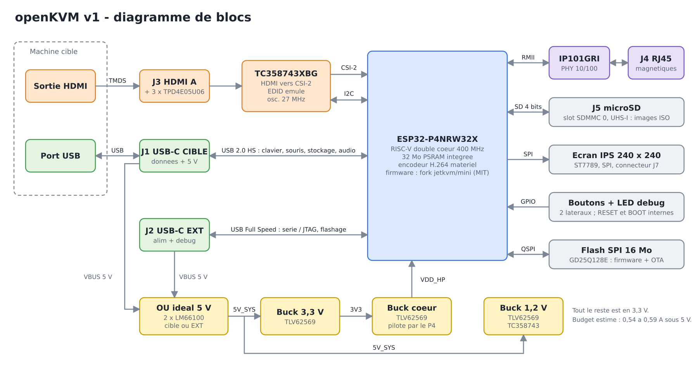

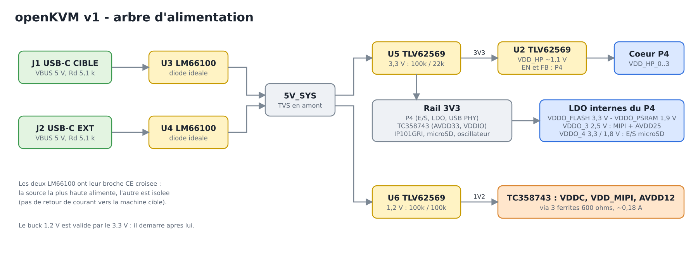

## La carte

| Dessus | Vue arrière |
|---|---|
| 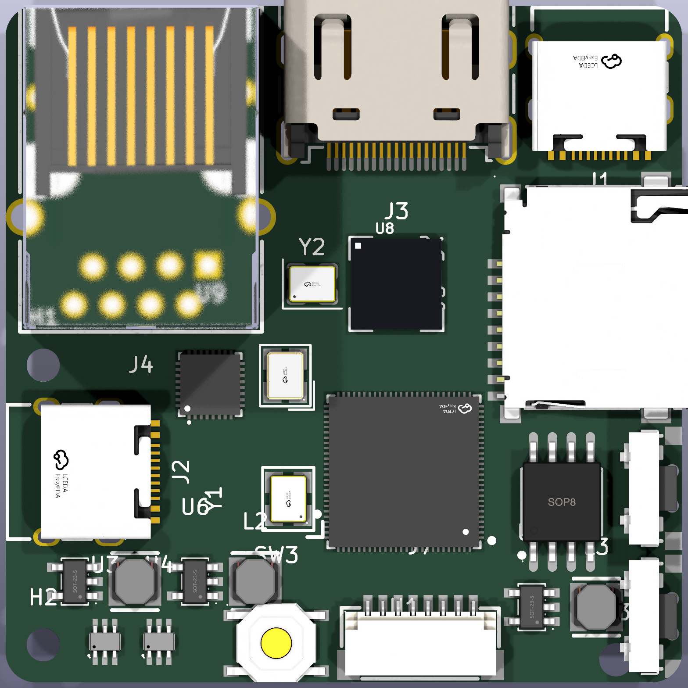 | 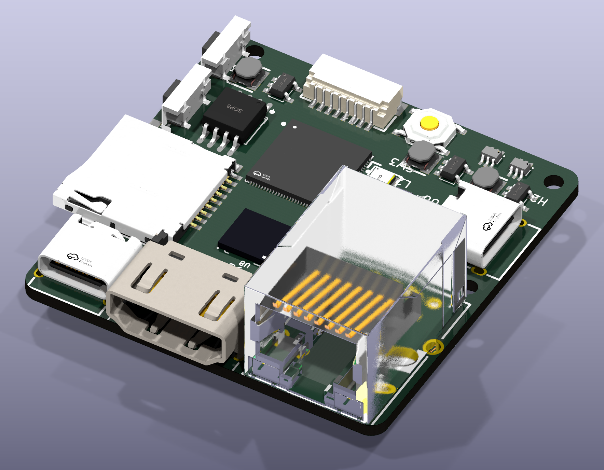 |

- **Arrière** : RJ45, HDMI, USB-C vers la machine cible.
- **Gauche** : USB-C « EXT » (alimentation, flashage, debug).
- **Droite** : microSD et deux boutons.
- **Dessus** : écran 240 × 240, posé sous le capot.

Le fichier [`hardware/openkvm.kicad_pcb`](hardware/openkvm.kicad_pcb) contient le contour, les 182 empreintes et tous
les nets. Les connecteurs et les puces principales sont placés ; **le routage reste à faire**.

## Le schéma

Six pages, disponibles en [PDF](hardware/exports/openkvm-schema.pdf) et dans KiCad 9.

| | |
|---|---|
| [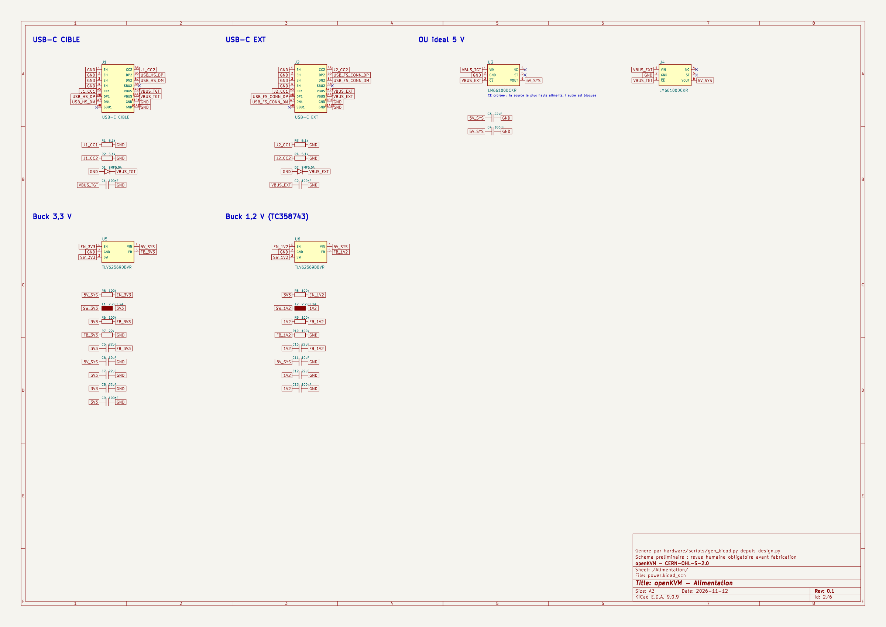](docs/images/schema-2-alimentation.png) Alimentation | [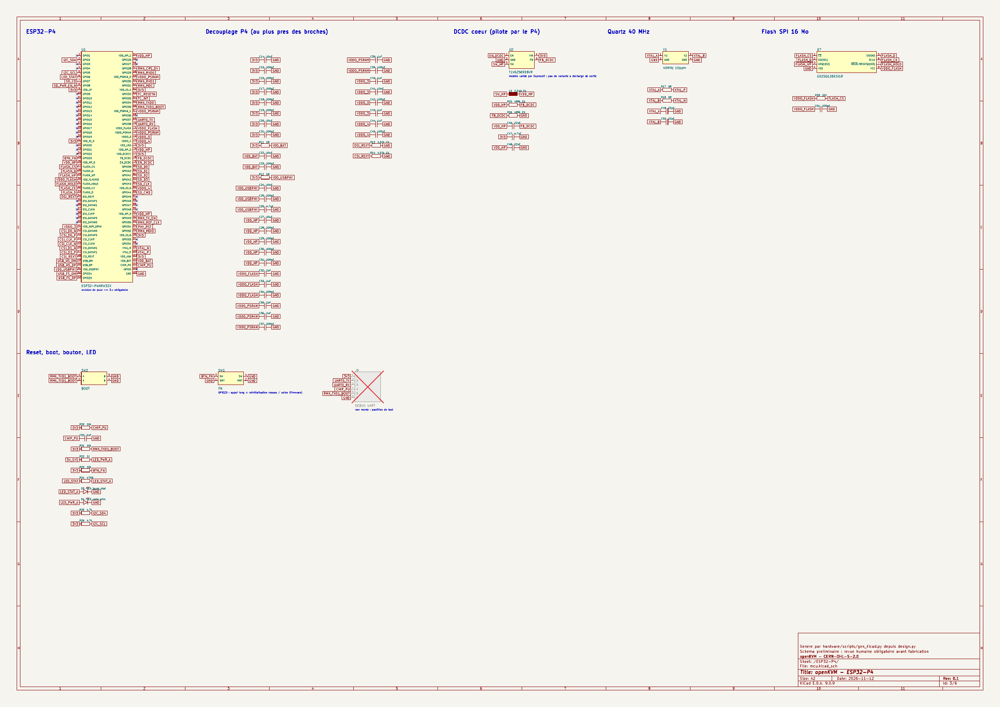](docs/images/schema-3-esp32-p4.png) ESP32-P4 |
| [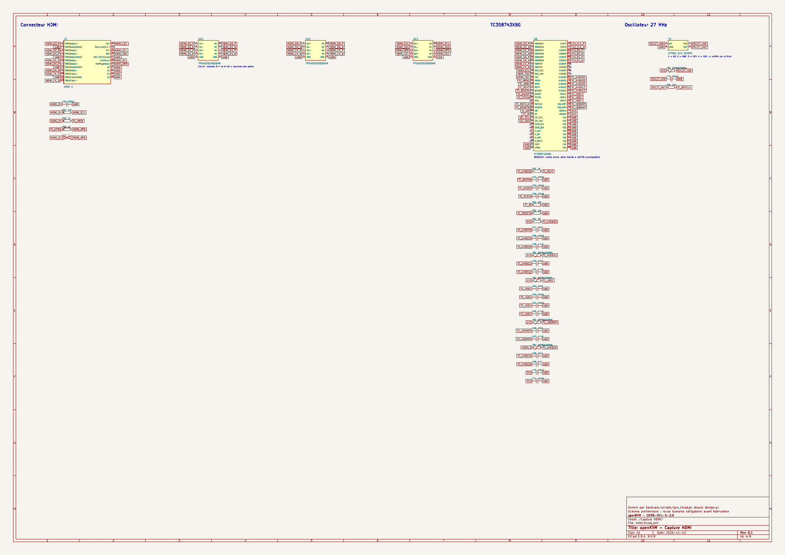](docs/images/schema-4-capture-hdmi.png) Capture HDMI | [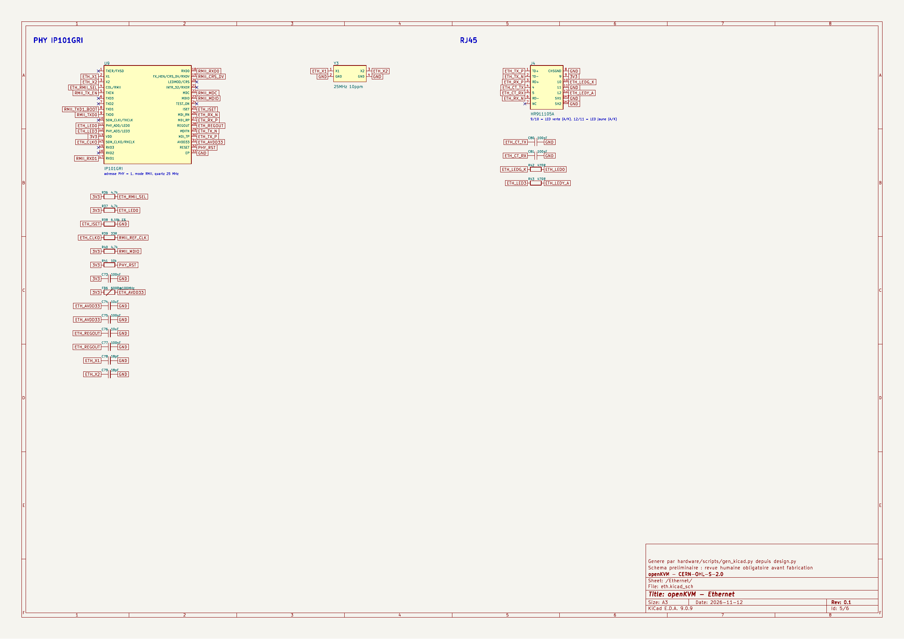](docs/images/schema-5-ethernet.png) Ethernet |
| [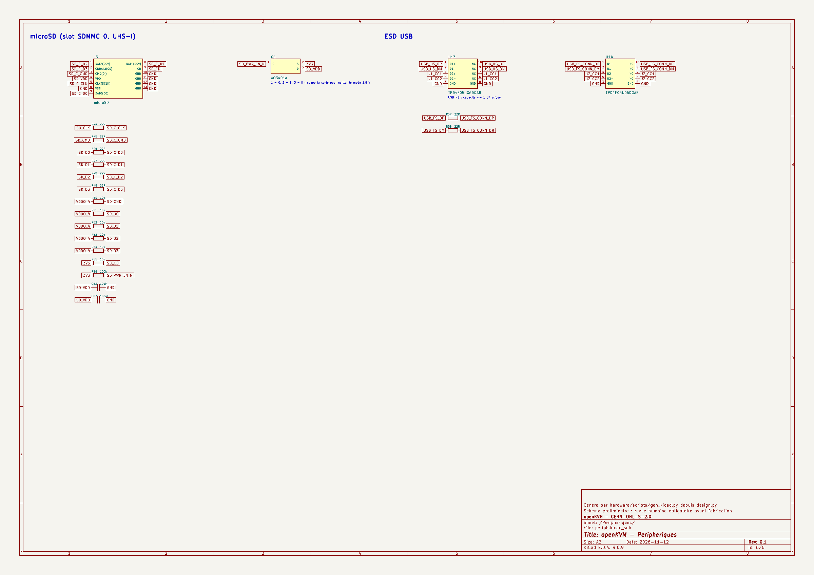](docs/images/schema-6-peripheriques.png) Périphériques | [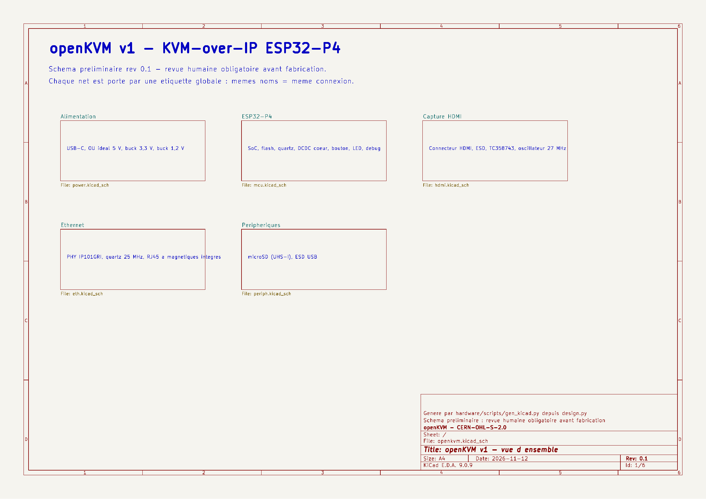](docs/images/schema-1-vue-ensemble.png) Vue d'ensemble |

Le schéma est généré depuis une description texte ([`design.py`](hardware/scripts/design.py)), puis KiCad en
ré-extrait la netlist pour la comparer à la source : **720 broches, 0 différence**.

## Le boîtier

| Arrière | Côté droit |
|---|---|
| 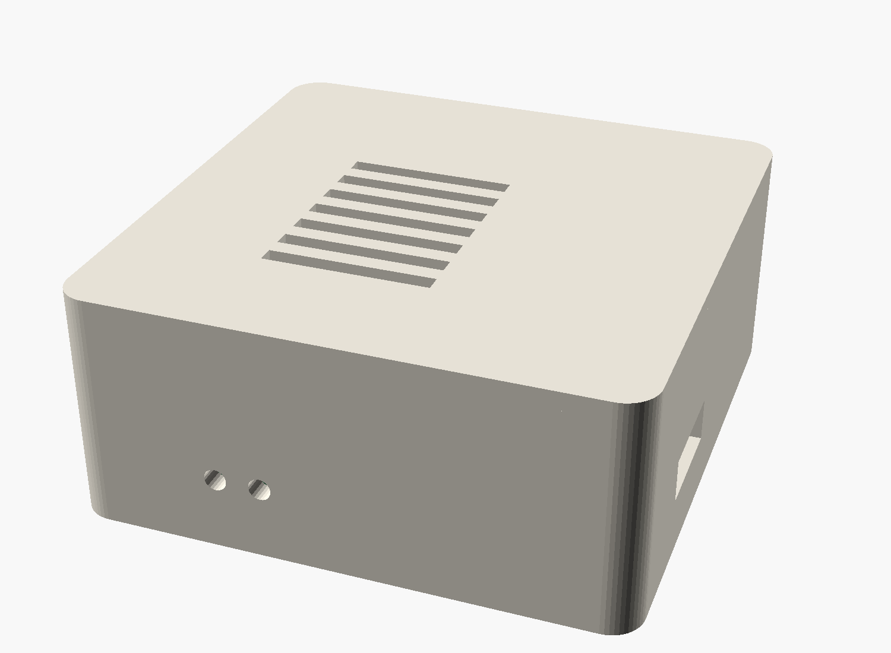 | 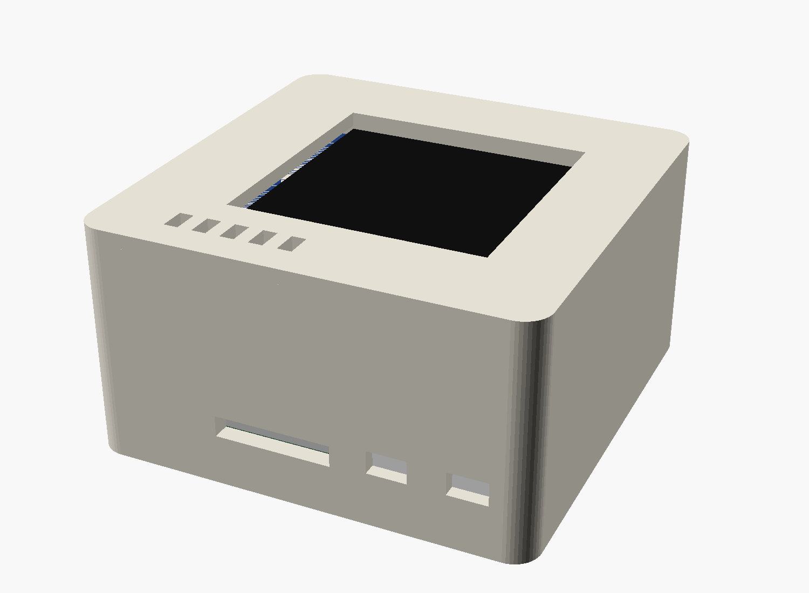 |

[`mechanical/openkvm-boitier-concept.scad`](mechanical/openkvm-boitier-concept.scad) est un modèle **paramétrique OpenSCAD**
qui sert d'aperçu : coque, capot à fenêtre, découpes des connecteurs. Les cotes définitives viendront au livrable 7,
une fois la carte routée. Pour ta propre CAO, la carte avec tous ses composants est dans
[`mechanical/openkvm-pcb-preplacement.step.zip`](mechanical/openkvm-pcb-preplacement.step.zip) (STEP, 3,3 Mo compressé)
et en [`GLB`](mechanical/openkvm-pcb-preplacement.glb) pour Blender ou un visualiseur web.

### Modèles 3D des composants

Chaque composant a un modèle dans [`hardware/lib/openkvm.3dshapes/`](hardware/lib/openkvm.3dshapes/) : 17 en **STEP et VRML**
(pièces LCSC, issues d'EasyEDA) et le BGA du TC358743, dessiné ici ([`gen_3d_bga.py`](hardware/scripts/gen_3d_bga.py)).
Deux sont **approximatifs**, à remplacer par ceux du fabricant pour tes cotes définitives :

- **TC358743 (BGA-64)** : corps 6 × 6 mm, épaisseur générique de 0,75 mm, **hauteur non vérifiée** sur la fiche technique ;
- **Oscillateur 27 MHz (Y2)** : forme générique 3,2 × 2,5 mm empruntée à l'oscillateur 40 MHz.

Le BGA n'existe qu'en VRML (KiCad ne sait pas l'exporter seul en STEP) ; il est inclus dans le STEP de la carte.

## Contenu du dépôt

```
docs/                       Les livrables, un par étape, avec leurs sources
  00-decision-architecture.md   Pourquoi ESP32-P4 et pas de Gigabit
  01-recherche-kvm-existants.md Comparatif JetKVM, NanoKVM, PicoKVM, PiKVM, Comet
  02-choix-soc-capture.md       ESP32-P4X et TC358743 : prix, stock, risques
  03-cahier-des-charges.md      Exigences, interfaces, budget de courant
  04-schema-electronique.md     Schéma, notes par bloc, points à relire
  05-bom-chiffree.md            BOM chiffrée, coût par carte, contraintes JLCPCB
  images/                       Rendus et diagrammes (sources dans images/src/)
hardware/                   Projet KiCad 9
  openkvm.kicad_pro/.kicad_sch  Schéma (5 feuilles)
  openkvm.kicad_pcb             Carte pré-placée, non routée
  fabrication/                  BOM JLCPCB, BOM chiffrée, instantané des prix
  exports/                      PDF du schéma, netlist et liste de composants en CSV
  lib/                          Symboles, empreintes, modèles 3D (.wrl + .step)
  scripts/                      design.py (source), générateurs, vérification
  build.sh                      Régénère tout
mechanical/                 Concept de boîtier (OpenSCAD), carte en STEP et en GLB
LICENSES/, LICENSE.md, NOTICE.md
```

## Utiliser les fichiers

**Ouvrir le projet** : KiCad 9, puis `hardware/openkvm.kicad_pro`.

**Régénérer** après une modification de `design.py` (il faut KiCad 9 avec `kicad-cli` et le module Python `pcbnew`) :

```bash
cd hardware && ./build.sh
```

Attention : `build.sh` réécrit `openkvm.kicad_pcb`. Une fois ton routage commencé, ne relance que le schéma
(`python3 scripts/gen_kicad.py`) et utilise « Mettre à jour le PCB depuis le schéma » dans KiCad.

**Commander chez JLCPCB**, quand la carte sera routée et relue :

| Fichier demandé par JLCPCB | Où | État |
|---|---|---|
| BOM | [`hardware/fabrication/openkvm-bom-jlcpcb.csv`](hardware/fabrication/openkvm-bom-jlcpcb.csv) | Prête, 1 ligne sans code LCSC (TC358743, à fournir) |
| Gerbers et perçages | À exporter depuis KiCad après routage | À faire |
| Fichier de placement (CPL) | À exporter depuis KiCad après routage | À faire |

## Avancement

| # | Livrable | État |
|---|---|---|
| 0 | Décision d'architecture | ✅ [`docs/00`](docs/00-decision-architecture.md) |
| 1 | Recherche sur les KVM existants | ✅ [`docs/01`](docs/01-recherche-kvm-existants.md) |
| 2 | Choix du SoC et de la puce de capture | ✅ [`docs/02`](docs/02-choix-soc-capture.md) |
| 3 | Cahier des charges et diagramme de blocs | ✅ [`docs/03`](docs/03-cahier-des-charges.md) |
| 4 | Schéma électronique | 🟡 rév. 0.1, à relire : [`docs/04`](docs/04-schema-electronique.md) |
| 5 | BOM chiffrée (prix sur 5 pièces) | 🟡 rév. 0.1, à valider : [`docs/05`](docs/05-bom-chiffree.md) |
| 6 | Spécifications de layout | ⏳ |
| 7 | Cotes du boîtier | ⏳ concept disponible |
| 8 | Firmware (fork du JetKVM Mini) | ⏳ |
| 9 | Plan de test et de mise en route | ⏳ |

## Risques connus

- **TC358743 obsolète** : introuvable chez LCSC, à acheter chez un broker (risque de contrefaçon).
- **HDMI, USB High Speed, MIPI** : signaux rapides, le routage demandera des impédances contrôlées.
- **BGA au pas de 0,65 mm** et QFN-104 : assemblage délicat, radiographie conseillée.
- **Consommation** : 0,54 à 0,59 A estimés sous 5 V, au-dessus des 500 mA d'un port USB 2.0.
- **Aucune certification CE/FCC** : prototypes à usage personnel.
- **HDCP non géré** : les contenus protégés donneront un écran noir.

## Licences

Matériel sous **CERN-OHL-S-2.0**, scripts sous **MIT**, documentation sous **CC-BY-SA-4.0**.
Détail dans [`LICENSE.md`](LICENSE.md), éléments repris de tiers dans [`NOTICE.md`](NOTICE.md).

« JetKVM » est une marque de BuildJet, Inc. openKVM est un projet indépendant.
