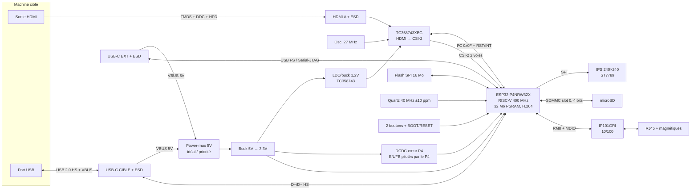

# 03 — Cahier des charges et diagramme de blocs

Date : **2026-11-12**. Statut : **proposition, à valider**.
Références : livrables [00](00-decision-architecture.md), [01](01-recherche-kvm-existants.md), [02](02-choix-soc-capture.md).
Les numéros entre crochets renvoient aux sources en fin de document.
Les mentions « estimation » signalent des chiffres **non mesurés**, à confirmer au bring-up (livrable 9).

## 1. Décisions déjà actées

| Sujet | Décision |
|---|---|
| SoC | ESP32-P4NRW32X (rév. ≥ 3.x), 32 Mo de PSRAM intégrée + 16 Mo de flash SPI externe |
| Capture | TC358743XBG (broker + consignation JLCPCB), CSI-2 2 voies |
| Réseau | Ethernet 10/100, PHY IP101GRI (RMII) |
| Assemblage | JLCPCB, série de 5 |
| Disposition | Celle du Mini : écran sur le dessus, boutons et microSD sur le côté |
| Audio | Carte son USB (UAC2) émulée, pas d'audio HDMI |
| Boîtier | Imprimé par toi en FDM, **enveloppe maximale 50 × 50 × 50 mm** |
| PoE | Non |
| Firmware | Fork de `jetkvm/mini` (MIT, copyright conservé, marque JetKVM retirée) |

## 2. Exigences

### 2.1 Fonctionnelles

| ID | Exigence | Critère d'acceptation |
|---|---|---|
| F-01 | Capturer la sortie HDMI de la machine cible | 1080p30 et 720p60 affichés dans le navigateur |
| F-02 | Encoder la vidéo en H.264 matériel et la diffuser en WebRTC | Latence perçue < 200 ms en réseau local (estimation, à mesurer) |
| F-03 | Émuler clavier, souris absolue/relative et clavier multimédia en USB HS | Fonctionne dans le BIOS/UEFI et sous Windows, Linux et macOS |
| F-04 | Stockage virtuel : CD-ROM / clé USB à partir d'une image sur microSD ou d'une URL | Démarrage d'un ISO d'installation Linux sur la cible |
| F-05 | Bibliothèque d'ISO persistante sur la microSD, envoi reprenable | Un envoi interrompu reprend sans repartir de zéro |
| F-06 | Carte son USB vers la cible, son renvoyé au navigateur en Opus | Son audible dans le navigateur |
| F-07 | Écran 240×240 : IP, MAC, état USB/HDMI, nombre de sessions | Lisible à 50 cm |
| F-08 | 2 boutons latéraux : navigation écran et mode | Actifs bas, anti-rebond logiciel |
| F-09 | Interface web locale (UI du fork), mot de passe, OIDC en option | Accessible via l'IP affichée |
| F-10 | Mises à jour OTA signées avec retour arrière automatique | 2 slots OTA de 6 Mo |
| F-11 | Wake-on-LAN, MQTT / Home Assistant, Tailscale | Repris du fork |
| F-12 | Port EXT : alimentation + USB FS (console série/JTAG de debug, extensions futures) | Flash du firmware possible par ce port |
| F-13 | Bascule automatique d'alimentation entre la cible et EXT, sans redémarrage | Débrancher l'une des deux sources ne fait pas rebooter |
| F-14 | Récupération : mode téléchargement accessible (bouton BOOT) même si le firmware est cassé | Reflash par EXT en mode téléchargement |

### 2.2 Performances

| ID | Exigence | Valeur cible |
|---|---|---|
| P-01 | Résolutions de capture | 1080p30, 720p60, plus les résolutions VESA courantes jusqu'à 1080p |
| P-02 | Débit Ethernet utile | ≥ 80 Mbit/s en TCP (le Mini ≈ 90 Mbit/s en UDP [5]) |
| P-03 | Débit microSD | ≥ 20 Mo/s en lecture (estimation UHS-I, à mesurer), pour ne pas brider l'USB MSC |
| P-04 | Démarrage | IP affichée en < 10 s après la mise sous tension (estimation) |
| P-05 | Consommation | **≤ 500 mA sous 5 V** en régime établi (comme le Mini), hors pics d'écriture SD |

### 2.3 Interfaces physiques

| Port | Connecteur | Rôle USB / électrique | Signaux |
|---|---|---|---|
| HDMI IN | HDMI type A femelle (pleine taille) | Récepteur (sink) | 3 paires TMDS + horloge, DDC (EDID émulé par le TC358743), HPD, +5 V détecté |
| USB-C « CIBLE » | USB-C 16 broches, device (UFP), Rd 5,1 kΩ sur CC1/CC2 | Alimentation par la cible + données **USB 2.0 HS** | VBUS, D+/D−, CC1/CC2 |
| USB-C « EXT » | USB-C 16 broches, UFP, Rd 5,1 kΩ | Alimentation + **USB FS** (USB Serial/JTAG du P4, GPIO24/25) | VBUS, D+/D−, CC1/CC2 |
| RJ45 | Embase avec magnétiques intégrées, 2 LED | 10/100BASE-TX | 2 paires + LED link/activité |
| microSD | Support push-push, accessible sur le côté | SD 4 bits, slot SDMMC 0 (UHS-I) | CLK, CMD, D0..D3, détection carte |
| Écran | IPS 1,54" 240×240, ST7789, nappe FPC | SPI 4 fils sans MISO | MOSI, SCLK, CS, DC, RST, BL |
| Boutons | 2 boutons tactiles latéraux + BOOT/RESET internes (accessibles au trombone) | GPIO | — |
| Debug | Pastilles de test UART0 (GPIO37/38), 3V3, GND, EN, BOOT | — | — |

### 2.4 Mécanique (détails au livrable 7)

| ID | Exigence |
|---|---|
| M-01 | Enveloppe extérieure ≤ **50 × 50 × 50 mm**. Objectif : **≈ 48 × 48 × 25 mm** |
| M-02 | PCB carré, cible **≤ 44 × 44 mm**, 4 couches, épaisseur 1,6 mm |
| M-03 | Écran sur la face supérieure, centré |
| M-04 | Boutons et microSD sur une face latérale |
| M-05 | HDMI, RJ45 et USB-C sur les faces arrière et latérales (répartition proposée au §5, à valider) |
| M-06 | 4 trous de fixation M2 (ou des colonnettes à insert thermique) |
| M-07 | Boîtier FDM en PETG ou ASA conseillé, à cause de la chaleur du P4 et du TC358743 ; PLA déconseillé (estimation) |
| M-08 | Ventilation passive : fentes au-dessus des puces chaudes, ou plaque thermique vers le couvercle |

### 2.5 Environnement, réglementation, licences

| ID | Exigence |
|---|---|
| E-01 | Usage en intérieur, 0-40 °C ambiant |
| E-02 | Protection ESD sur tous les connecteurs externes (USB HS : diodes **≤ 1 pF** [1]) |
| E-03 | **Aucune certification CE/FCC** : ce sont des prototypes à usage personnel. À dire clairement dans le README. |
| E-04 | HDCP non supporté : les contenus protégés afficheront un écran noir |
| L-01 | Matériel : **CERN-OHL-S-2.0** (proposé, voir questions) |
| L-02 | Firmware : **MIT** (fork, `LICENSE` et copyright JetKVM conservés), nouveaux fichiers en MIT |
| L-03 | Documentation : CC-BY-SA-4.0 (proposé) |

### 2.6 Coût

| ID | Exigence |
|---|---|
| C-01 | Coût unitaire (BOM + PCB + assemblage JLCPCB + TC358743 broker), **calculé sur 5 pièces, hors port et douane** : **< 39 $** |
| C-02 | Si C-01 est impossible à cause des frais fixes JLCPCB sur 5 pièces, le livrable 5 donnera aussi le coût à 10 et 20 pièces, et le coût sans assemblage BGA |

## 3. Diagramme de blocs



Version texte, si le Mermaid ne s'affiche pas :

```
 HDMI ─ESD─► TC358743 ══CSI-2 x2══► ┌──────────────────┐ ◄═RMII═► IP101 ─► RJ45
                 ▲ 27 MHz  ◄─I²C───► │  ESP32-P4NRW32X  │ ◄─SDMMC0─► microSD
 USB-C CIBLE ═HS═══════════════════► │  (32 Mo PSRAM)   │ ─SPI─► écran 240×240
 USB-C EXT  ═FS (Serial/JTAG)══════► └──────────────────┘ ◄─ boutons
   │VBUS          │VBUS                    ▲ QSPI flash 16 Mo, quartz 40 MHz
   └──► power-mux 5 V ──► buck 3,3 V ──► DCDC cœur P4 / LDO 1,2 V TC358743
```

## 4. Alimentation

### 4.1 Rails

| Rail | Source | Consommateurs | Remarques |
|---|---|---|---|
| 5V_SYS | Power-mux (VBUS CIBLE / VBUS EXT) | Buck 3,3 V, VBUS de la microSD si besoin | Protection : fusible réarmable + TVS à l'entrée (livrable 4) |
| 3V3 | Buck 5 V → 3,3 V | P4 (VDD_LP, VDD_IO_x, VDD_LDO, VDD_DCDCC, VDD_USBPHY), TC358743 (AVDD33, VDDIO1, VDDIO2, APLL en 3,3 V), IP101, écran, microSD | Le P4 recommande une alimentation unique en 3,3 V [1] |
| VDD_HP (~1,1 V) | DCDC externe **de la liste validée par Espressif** : ETA3485, SY8088, RY3420, BL8028, LP3219 ou TLV62569DBVR [1] | Cœur du P4 | EN_DCDC et FB_DCDC **pilotés par le P4**. Pas de convertisseur avec décharge de sortie [1] |
| 1V2 | LDO ou petit buck depuis 3,3 V | TC358743 : VDDC1/2, VDDMIPI, AVDD12 | ≈ 0,18 A à 1080p60 d'après le datasheet [2] |
| VDDO_3 (LDO interne P4) | P4 | Oscillateur 27 MHz du TC358743 | Comme le Mini [3]. Max 50 mA [1] |
| VDDO_4 (LDO interne P4) | P4 | VDD_IO_5 + pull-ups SD, pour basculer en 1,8 V en UHS-I | Recommandation Espressif [1] |

### 4.2 Budget de consommation (estimation)

| Bloc | Courant | Puissance | Source du chiffre |
|---|---|---|---|
| ESP32-P4 (flash et PSRAM comprises) | ≥ 380 mA @ 3,3 V | ≥ 1,25 W | Minimum de dimensionnement Espressif [1] |
| TC358743 à 1080p60 | — | 0,54 W | Datasheet [2] |
| IP101GRI | ~ ? | 0,1-0,3 W | **Non vérifié** (livrable 4) |
| Écran + rétroéclairage | ~20-40 mA | 0,07-0,13 W | **Non vérifié** |
| microSD en écriture | jusqu'à ~100 mA (pics) | ~0,3 W | **Non vérifié** |
| **Total sur 3,3 V** | | **≈ 2,3-2,5 W** | |
| **Entrée 5 V** (buck à ~85 % de rendement) | **≈ 540-590 mA** | | **Estimation** |

⚠️ **Conclusion** : on risque de **dépasser un peu les 500 mA** d'un port USB 2.0 de la cible quand la microSD écrit.
Le Mini annonce 5 V / 500 mA. Le P4 consomme probablement moins que les 380 mA de dimensionnement en usage réel.
Il faudra mesurer au bring-up. Si besoin, on recommandera d'**alimenter par EXT** pendant l'envoi d'ISO.

## 5. Brochage préliminaire du P4 (base : Mini, adapté)

| Fonction | GPIO | Origine | Changement vs Mini |
|---|---|---|---|
| Écran MOSI / SCLK / BL | 3 / 13 / 4 | Mini [3] | — |
| Écran DC / RST / CS | 20 / 21 / 22 | Mini | — |
| Bouton SW2 / SW3 | 47 / 23 | Mini | — |
| TC358743 SDA / SCL | 2 / 5 | Mini | — |
| TC358743 RESETN / INT | 32 / 33 | Mini | — |
| TC358743 CSI-2 | Broches MIPI dédiées | Mini | — |
| RMII MDC / MDIO | 31 / 52 | Défaut ESP-IDF 6.0.2 [4] | — |
| RMII TX_EN / TXD0 / TXD1 | 49 / 34 / 35 | Défaut ESP-IDF | ⚠️ 34/35 sont des **broches de strapping** [1] |
| RMII CRS_DV / RXD0 / RXD1 | 28 / 29 / 30 | Défaut ESP-IDF | — |
| RMII REF_CLK 50 MHz (entrée) | 50 | Défaut ESP-IDF | Fourni par l'IP101 |
| Reset PHY | 51 | Mini | — |
| microSD CLK / CMD / D0..D3 | 43 / 44 / 39..42 | Slot SDMMC 0 (IOMUX, UHS-I) [1] | **Changé** : le Mini Ethernet utilise le slot 1 (GPIO matrix) |
| Détection carte microSD | à définir | — | Nouveau |
| USB HS (cible) | DP / DM dédiées | Mini | — |
| USB Serial/JTAG (EXT) | 24 / 25 | Mini (console secondaire) | — |
| UART0 TX / RX (pastilles) | 37 / 38 | Défaut P4 [1] | Strapping : ne rien charger |
| BOOT | 35 (strapping) | [1] | Pull-up recommandé, pas de grosse capa [1] |

Ce brochage reste très proche du Mini, donc seul `components/jetkvm_board_config` changera, plus le slot SD.
Il sera revérifié broche par broche contre le datasheet au livrable 4.

## 6. Répartition des ports sur le boîtier (proposition)

Largeur approximative des connecteurs : RJ45 ≈ 16 mm, HDMI A ≈ 15 mm, USB-C ≈ 9 mm.
Les quatre côte à côte font ≈ 49 mm, plus que les ≈ 44 mm de PCB visés. D'où cette proposition :

| Face | Éléments |
|---|---|
| Arrière | RJ45 + HDMI + USB-C CIBLE (≈ 40 mm avec les espacements) |
| Gauche | USB-C EXT (alimentation) |
| Droite | microSD + 2 boutons (comme le Mini) |
| Dessus | Écran 240×240 |
| Dessous | Trous d'accès BOOT / RESET au trombone, aérations |

Les largeurs exactes viendront des références choisies au livrable 4. Ce sont des ordres de grandeur, pas des cotes.

## 7. Hors périmètre v1
- Gigabit (piste v2 RV1126B, livrable 00) ; Wi-Fi (la variante Mini W utilise un ESP32-C5).
- PoE, sortie HDMI loop-through, contrôle ATX intégré (possible plus tard via le port EXT).
- Certification CE/FCC.

## Sources

1. Espressif — *ESP32-P4 Hardware Design Guidelines* (alim. 3,3 V, 380 mA min., DCDC externe validés, LDO VDDO_3/4, slot SDMMC 0 UHS-I GPIO39-48, strapping GPIO34-38, UART0 GPIO37/38, USB FS GPIO24-27, ESD ≤ 1 pF en HS) — https://docs.espressif.com/projects/esp-hardware-design-guidelines/en/latest/esp32p4/esp-hardware-design-guidelines-en-master-esp32p4.pdf
2. Toshiba — *TC358743XBG Datasheet* (2014-05-16 ; rails 1,2 / 1,8-3,3 / 3,3 / 2,5-3,3 V ; 0,48 W en 720p60, 0,54 W en 1080p60 ; CSI-2 4 voies × 1 Gbit/s ; EDID SRAM 1 Ko ; REFCLK 26/27/42 MHz) — https://e2echina.ti.com/cfs-file/__key/telligent-evolution-components-attachments/00-58-01-00-00-20-77-18/TC358743XBG_5F00_datasheet_5F00_en_5F00_20140516.pdf
3. GitHub `jetkvm/mini` (MIT) : `docs/hardware-variants.md`, `components/jetkvm_board_config`, `components/jetkvm_hdmi_bridge`, `sdkconfig.defaults` — https://github.com/jetkvm/mini
4. ESP-IDF v6.0.2 — `components/esp_eth/include/esp_eth_mac_esp.h` (`ETH_ESP32_EMAC_DEFAULT_CONFIG` pour ESP32-P4) — https://github.com/espressif/esp-idf/blob/v6.0.2/components/esp_eth/include/esp_eth_mac_esp.h
5. Forum ESP32 — *ESP32-P4: Internal Ethernet MAC vs external SPI Ethernet controller* — https://esp32.com/viewtopic.php?p=139811
6. JetKVM — *Introducing JetKVM Mini* (5 V, double alimentation, disposition) — https://jetkvm.com/blog/introducing-jetkvm-mini ; https://jetkvm.com/docs/devices/jetkvm-mini
