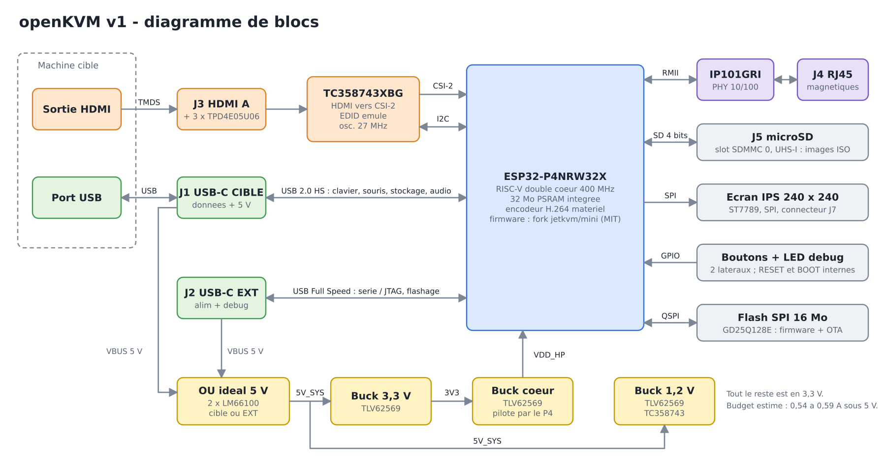
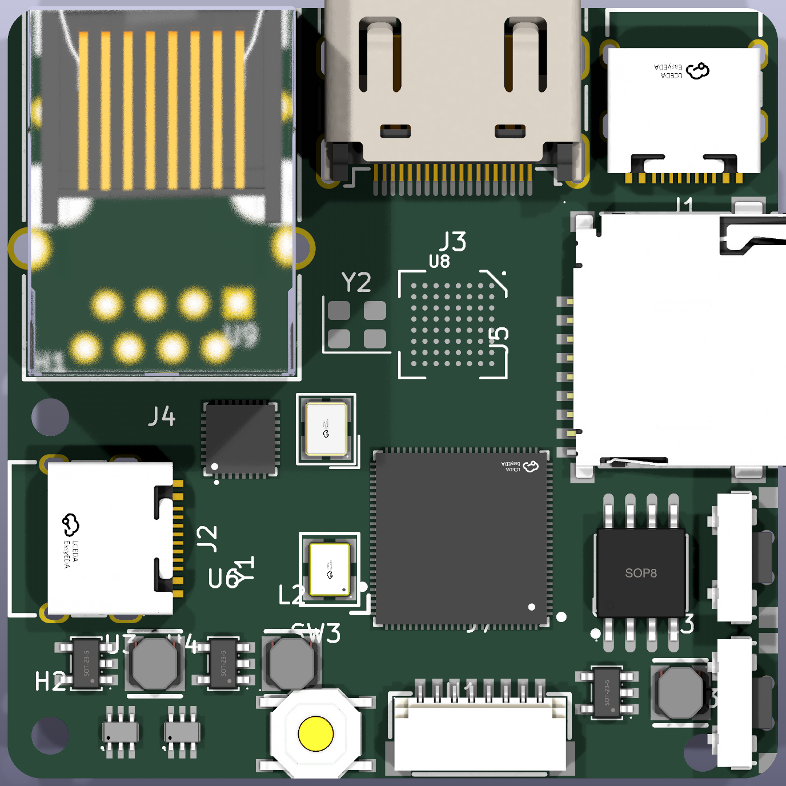
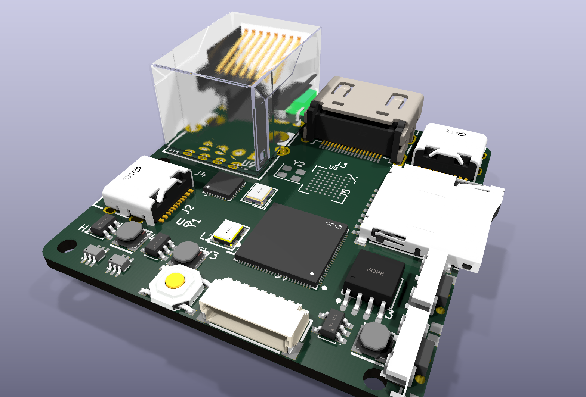
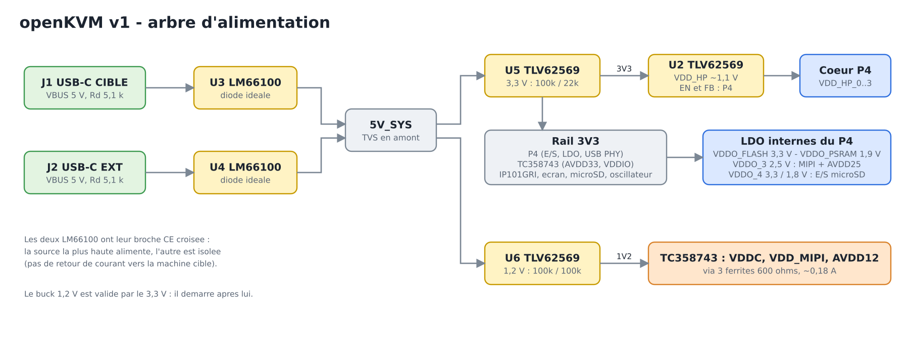

# 04 — Schéma électronique

Date : **2026-11-12**. Révision du schéma : **0.1**. Statut : **préliminaire, à faire relire avant toute fabrication**.
Outil : **KiCad 9** (gratuit, fichiers texte, exporte tout ce que JLCPCB demande).

> ⚠️ Ce schéma n'a **jamais été fabriqué ni testé**. Il est construit à partir de schémas de référence publics
> et de fiches techniques, puis vérifié par outil (netlist). Il lui manque une **revue humaine** (§6) et le routage.



## 1. Ce qui est livré

| Fichier | Contenu |
|---|---|
| [`hardware/openkvm.kicad_pro`](../hardware/openkvm.kicad_pro) | Projet KiCad 9 : à ouvrir en premier |
| `hardware/openkvm.kicad_sch` + 5 feuilles | Schéma : alimentation, ESP32-P4, capture HDMI, Ethernet, périphériques |
| [`hardware/exports/openkvm-schema.pdf`](../hardware/exports/openkvm-schema.pdf) | Le schéma en PDF (6 pages) |
| [`hardware/openkvm.kicad_pcb`](../hardware/openkvm.kicad_pcb) | Carte 45 × 45 mm, 4 couches : contour, empreintes, **tous les nets chargés**, pré-placement. **Non routée.** |
| [`hardware/fabrication/openkvm-bom-jlcpcb.csv`](../hardware/fabrication/openkvm-bom-jlcpcb.csv) | BOM au format JLCPCB (`Comment, Designator, Footprint, LCSC Part #`) |
| [`hardware/exports/netlist.csv`](../hardware/exports/netlist.csv) | Netlist logique : 137 nets, broche par broche |
| [`hardware/exports/composants.csv`](../hardware/exports/composants.csv) | Liste des 182 composants avec bloc, empreinte, référence LCSC et note |
| `hardware/lib/` | Symboles, empreintes et modèles 3D (pièces LCSC + empreinte BGA du TC358743) |
| `hardware/scripts/` | `design.py` (source de vérité), générateurs et vérification |

**Chiffres** : 182 composants, 137 nets, 47 lignes de BOM, 720 broches.

### Comment c'est fabriqué
Le schéma est **généré** depuis [`hardware/scripts/design.py`](../hardware/scripts/design.py), qui décrit chaque composant et chaque
broche. Il est en style « étiquettes » : chaque broche porte le nom de son net, deux étiquettes identiques sont reliées.
Ce n'est pas le plus joli des schémas, mais il est reproductible et vérifiable.

```sh
cd hardware && ./build.sh     # régénère schéma, PCB pré-placé, BOM et PDF
```

### Vérifications faites par outil
| Vérification | Résultat |
|---|---|
| KiCad relit le schéma, extrait sa netlist, comparaison broche par broche avec `design.py` (`verify_netlist.py`) | **720 broches, 0 différence** |
| Chaque numéro de broche de symbole existe sur l'empreinte | OK pour les 18 pièces LCSC |
| Parité schéma / PCB (`kicad-cli pcb drc --schematic-parity`) | OK ; seuls les 3 trous de fixation sont « en plus », c'est normal |
| Courts-circuits entre pastilles sur le pré-placement | 0 |

Le DRC signale encore 16 écarts d'isolement **internes** aux empreintes à pas fin (ESP32-P4, USB-C) avec les règles
par défaut de KiCad, et 2 chevauchements de zones de garde. Ils se règlent avec les règles de conception du livrable 6.

## 2. Aperçu du pré-placement

| Dessus | Vue 3D |
|---|---|
|  |  |

Les connecteurs et les puces principales sont à leur place prévue. Les ~150 passifs sont rangés par bloc **sous la carte**
dans le fichier `.kicad_pcb` : c'est à toi de les placer pendant le layout.

| Face | Éléments (repère : origine au coin arrière gauche, en mm) |
|---|---|
| Arrière | RJ45 J4 (x = 9), HDMI J3 (x = 26, dépasse de ~1,3 mm), USB-C CIBLE J1 (x = 39,5) |
| Gauche | USB-C EXT J2 (y = 31) |
| Droite | microSD J5 (y = 19,4), boutons SW1 (y = 32,1) et SW2 (y = 40,6) |
| Bas | Connecteur écran J7, bouton BOOT SW3 |

## 3. Notes de conception par bloc

### 3.1 Alimentation et protections


- **Deux entrées 5 V** (USB-C CIBLE et EXT), chacune avec une TVS SMF5.0A et 100 nF.
- **OU idéal** : 2 × LM66100, broches CE croisées (montage « dual ideal diode ORing » de TI). La source la plus haute
  alimente `5V_SYS` ; l'autre est isolée, donc pas de retour de courant vers la machine cible.
- **3,3 V** : TLV62569 (2 A), pont 100 k / 22 k → 3,33 V, inductance 2,2 µH.
- **1,2 V** pour le TC358743 : TLV62569 depuis `5V_SYS`, pont 100 k / 100 k. Validé par le 3,3 V, donc il démarre après.
  Un buck plutôt qu'un LDO : un LDO dissiperait ~0,4 W dans un boîtier fermé.
- **Cœur du P4** : TLV62569 **piloté par le P4** (`EN_DCDC`, `FB_DCDC`), 2 × 499 kΩ + 22 pF, exactement la figure 5 du guide Espressif.
- **LDO internes du P4** : `VDDO_FLASH` (flash), `VDDO_PSRAM`, `VDDO_3` à 2,5 V (PHY MIPI du P4 + `AVDD25` du TC358743),
  `VDDO_4` (E/S microSD, 3,3 V ou 1,8 V).
- Pas de fusible réarmable en v0.1 : le port USB amont limite déjà le courant. À rediscuter en revue.

### 3.2 USB-C (CC, données, ESD)
- Les deux ports sont des **périphériques** : 5,1 kΩ sur CC1 et CC2 (Rd). Pas de négociation Power Delivery, 5 V seulement.
- **CIBLE** : D+/D− directs vers le PHY **USB 2.0 High Speed** du P4, ESD TPD4E05U06 (0,5 pF ; Espressif exige ≤ 1 pF).
- **EXT** : D+/D− vers GPIO25/GPIO24 (**USB Serial/JTAG** du P4) à travers 22 Ω. Ce port sert donc à flasher et déboguer
  sans convertisseur USB-série.
- Les canaux libres des TPD4E05U06 protègent CC1 et CC2.

### 3.3 HDMI, DDC, HPD, EDID
Circuit repris du projet ouvert **Antmicro hdmi-mipi-bridge** (Apache-2.0), adapté à 2 voies CSI.
- **TMDS** : 4 paires directes du connecteur au TC358743, 2 × TPD4E05U06 en traversée.
- **EDID** : émulé par le TC358743 (RAM interne de 1 Ko écrite par le firmware). Aucune EEPROM.
- **DDC** : direct (broches tolérantes 5 V d'après la fiche technique), 47 kΩ de rappel sur SCL vers le +5 V HDMI.
  Antmicro met un répéteur PCA9517 ; je l'ai supprimé pour le coût. **Point à relire.**
- **HPD** : piloté par la sortie `HPDO` du TC358743 à travers 1 kΩ, pour que le firmware puisse forcer la relecture de l'EDID.
  Variante Antmicro (HPD bouclé sur le +5 V) prévue par R30, **non montée**.
- **Horloge** : oscillateur 27 MHz en 3,3 V, 22 Ω en série. Le Mini l'alimente par le LDO du P4 ; ici il est sur le 3,3 V
  pour garantir les niveaux logiques de `REFCLK`.
- **CSI-2** : 2 voies + horloge vers le P4. Les voies 2 et 3 du pont restent en l'air.
- **I²C** : GPIO2 (SDA) / GPIO5 (SCL), 4,7 kΩ. **RESETN** : GPIO32, tiré à la masse par 10 kΩ. **INT** : GPIO33.
- **Audio I²S** : non câblé (le son passe par USB, comme sur le Mini).

### 3.4 Ethernet
- **IP101GRI** en RMII, adresse PHY 1 (strap `PHY_AD0` à 1), quartz 25 MHz.
- Le PHY **fournit** le 50 MHz au P4 (GPIO50) à travers 33 Ω.
- Terminaisons 49,9 Ω **intégrées** au PHY ; points milieux du transformateur découplés par 100 nF, sans tension (exigence IP101G).
- **HR911105A** : magnétiques et terminaison « Bob Smith » intégrées. LED verte = lien, LED jaune = 100 M / activité.
- GPIO35 est à la fois `RMII_TXD1` et le **strap BOOT** du P4, comme sur la carte d'évaluation Espressif : rappel 10 kΩ au 3,3 V.

### 3.5 Écran
- Connecteur JST-SH 8 broches (J7), même ordre que le module **MSP1541** (1,54", ST7789, 240 × 240) :
  `GND, VCC, SCL, SDA, RES, DC, CS, BLK`. Le module se pose sous le capot, relié par une nappe de 8 fils.
- Rétroéclairage commandé directement par GPIO4 (le module a son propre transistor). **À vérifier sur ton module.**

### 3.6 Boutons, LED
- **SW1 (NAV, GPIO47)** et **SW2 (MODE, GPIO23)** : poussoirs latéraux, actifs à l'état bas, rappels 10 kΩ.
  Le rappel de SW1 va sur `VDDO_4`, car GPIO47 est dans le domaine d'alimentation de la microSD.
- **SW3 (BOOT, GPIO35)** : interne, pour la récupération (le maintenir en branchant l'alimentation).
- **Pas de bouton RESET** : débrancher suffit, et `CHIP_PU` est sur le connecteur de debug.
- **LED de debug** verte sur GPIO6, 1 kΩ.

### 3.7 UART, JTAG, programmation
- Flashage normal : **USB-C EXT** (USB Serial/JTAG intégré au P4, passage en mode téléchargement automatique).
- Secours : J8 (6 pastilles, non monté) : `3V3, TX0 (GPIO37), RX0 (GPIO38), CHIP_PU, BOOT, GND`.

### 3.8 microSD
- **Slot SDMMC 0** du P4 (GPIO39 à 44), le seul compatible **UHS-I** : c'est le changement fait pour accélérer les ISO.
- E/S et rappels 10 kΩ alimentés par `VDDO_4`, qui bascule de 3,3 V à 1,8 V en UHS-I. 22 Ω en série sur chaque ligne.
- **Q1 (AO3401A)** coupe l'alimentation de la carte (GPIO8) : indispensable pour la faire sortir du mode 1,8 V après un reset.
- Détection de carte sur GPIO7.

## 4. Écarts par rapport au JetKVM Mini

| Sujet | Mini (d'après son firmware) | openKVM v0.1 | Impact firmware |
|---|---|---|---|
| microSD | Slot SDMMC 1 | Slot 0, UHS-I, coupure d'alimentation (GPIO8), détection (GPIO7) | Initialisation SD à adapter |
| Oscillateur 27 MHz | Alimenté par `VDDO_3` | Alimenté par le 3,3 V | Aucun |
| LED de debug | Aucune | GPIO6 | Optionnel |
| Écran, boutons, I²C, pont HDMI, PHY | — | **Brochage identique** | Aucun |

## 5. BOM : ce qui reste à trancher (livrable 5)

| Pièce | Statut |
|---|---|
| TC358743XBG (U8) | Pas chez LCSC : achat broker, à fournir à JLCPCB |
| 4,02 kΩ 1 % (R13, R14), 499 kΩ 1 % (R15, R16), 6,19 kΩ 1 % (R38) | Référence LCSC à choisir |
| Oscillateur 27 MHz (Y2) | C2992365 : seulement 27 en stock ; alternatives C160453, C390805 |
| Flash GD25Q128ESIGR (U7) | C2928891, 1 091 en stock ; compatibilité de mode QIO à vérifier avec le firmware |
| Module écran MSP1541 | Hors assemblage JLCPCB, à acheter à part |

Toutes les autres lignes portent un code LCSC **vérifié en stock le 2026-11-12**.

## 6. Points à faire relire par un humain avant fabrication

1. **Séquence d'alimentation du TC358743** (3,3 V, puis 1,2 V, puis 2,5 V à l'activation du LDO) : la fiche publique ne la précise pas.
2. **HPD piloté par `HPDO` en 3,3 V** et **DDC sans répéteur** : fonctionne sur le papier, à valider sur plusieurs sources HDMI.
3. **Brochage de l'oscillateur 27 MHz** (1 = EN, 2 = GND, 3 = OUT, 4 = VDD) : à confirmer sur la fiche de la référence achetée.
4. **LM66100** : tension max 5,5 V, TVS à 9,2 V de limitation ; la broche ST est laissée en l'air. À confirmer sur la fiche TI.
5. **Condensateurs des quartz** (22 pF et 18 pF) : valeurs calculées, à ajuster à la mesure.
6. **GPIO libres choisis** (6, 7, 8) : vérifier qu'ils n'ont pas de rôle caché dans le firmware du Mini.
7. **UHS-I** : prise en charge par l'ESP-IDF à valider ; sinon la carte fonctionne en 3,3 V « high speed ».
8. **Empreinte BGA 0,65 mm** et **QFN-104** : vérifier les ouvertures de pâte et les capacités de JLCPCB.
9. **Pas de fusible** ni de limitation de courant en entrée.
10. **Budget de courant** (0,54 à 0,59 A estimés sous 5 V) : supérieur aux 500 mA d'un port USB 2.0.

## Sources

1. Espressif — *ESP32-P4 Hardware Design Guidelines* (fig. 1 schéma de référence, fig. 5 DCDC TLV62569, SDIO, USB, straps) — https://docs.espressif.com/projects/esp-hardware-design-guidelines/en/latest/esp32p4/esp-hardware-design-guidelines-en-master-esp32p4.pdf
2. Antmicro — *HDMI to MIPI CSI-2 Bridge* (KiCad, Apache-2.0) — https://github.com/antmicro/hdmi-mipi-bridge
3. Toshiba — *TC358743XBG Datasheet* — https://e2echina.ti.com/cfs-file/__key/telligent-evolution-components-attachments/00-58-01-00-00-20-77-18/TC358743XBG_5F00_datasheet_5F00_en_5F00_20140516.pdf
4. GitHub `jetkvm/mini` (MIT) — brochage : `docs/hardware-variants.md`, `components/jetkvm_board_config`, `components/jetkvm_hdmi_bridge/tc358743_regs.h` — https://github.com/jetkvm/mini
5. IC Plus — *IP101G Data Sheet* — https://datasheet.lcsc.com/datasheet/pdf/14f15850d1faf0804f05f4a04b553bc6.pdf?productCode=C703537
6. HanRun — *HR911105A* — https://datasheet.lcsc.com/datasheet/pdf/0ad5e0c00dfc47fb8e582f15f877f290.pdf?productCode=C12074
7. LCDWiki — *1.54inch IPS Module MSP1541 User Manual* — https://www.lcdwiki.com/res/MSP1541/1.54inch_4-line-SPI_IPS_Module_MSP1541_User_Manual_EN.pdf
8. ESP-IDF v6.0.2 — `esp_eth_mac_esp.h` (broches RMII par défaut) — https://github.com/espressif/esp-idf/blob/v6.0.2/components/esp_eth/include/esp_eth_mac_esp.h
9. LCSC — fiches produit (API, 2026-11-12) : C54540373, C703537, C12074, C165948, C91145, C138388, C141836, C2869734, C138714, C2928891, C9010, C9006, C2992365, C318936, C318884, C160407, C19077497, C15127, C12624, C85833 — https://www.lcsc.com/product-detail/C54540373.html (même schéma d'URL)
10. JLCPCB — *SWPA3015S2R2MT* (C43389) — https://jlcpcb.com/partdetail/C43389
11. Symboles et empreintes LCSC convertis avec `easyeda2kicad` — https://github.com/uPesy/easyeda2kicad.py
